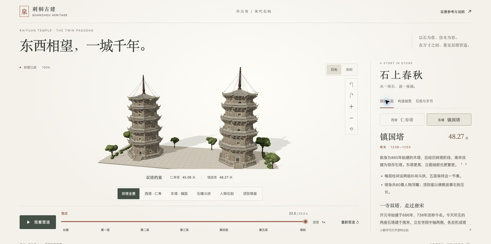
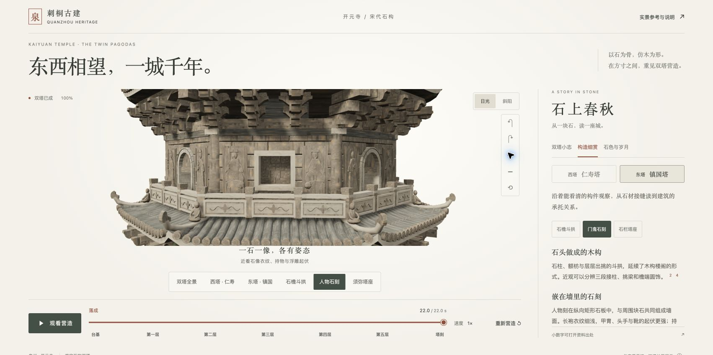

# 泉州开元寺 · 东西双塔

> 东西相望，一城千年。
>
> 以石为骨，仿木为形。

以泉州开元寺的仁寿塔与镇国塔为主角，在浏览器中展开一场可交互的古建营造。石座逐层垒起，斗拱向外承挑，五重石檐徐徐成形；拉近镜头，可以细看人物石刻、栏板卷草、檐角铜铃与塔刹链环。

本项目以 Hailey 的开源 [threejs-architecture-effects](https://github.com/lhlGitHub/threejs-architecture-effects) 及其「营造 · 建筑生长」示例为起点，参考原版的古建图录式呈现与逐构件动画方法，结合实景照片、航拍核对和建筑图解，重新制作双塔几何、石材材质与近观视角。

使用 **React + Three.js** 构建真实、可环视的三维场景。拖动旋转、滚轮近观，或沿一条 **22 秒营造时间轴** 播放、暂停、倒拖与重演，在构件的层层相承中观察双塔的形制。





## 运行

需要 Node.js 22.13 或更新版本及 npm。

macOS 可双击 `启动双塔.command`，打开 http://127.0.0.1:5179 。运行时保持终端窗口打开。

或手动运行：

```sh
git clone https://github.com/xypasolini-droid/quanzhou-twin-pagodas.git
cd quanzhou-twin-pagodas
npm ci
npm run dev -- --port 5179 --strictPort
```

构建检查：`npm run build`。构建后可运行 `npm run preview -- --port 5179 --strictPort`。

## 玩法

- 拖动旋转、滚轮缩放；画面右侧提供同等功能按钮。
- 切换双塔、仁寿塔、镇国塔、石檐斗拱、人物石刻与须弥塔座视角。
- 点击“观看营造”播放22秒组装过程；支持暂停、0.5/1/2倍速。
- 拖动时间轴会自动暂停；点击阶段文字直接查看对应阶段完成状态。
- “重新营造”从台基开始重演。原来的营造流程保持不变。
- 日光与斜阳呈现同一石面在不同光线下的冷暖；右侧“双塔小志”补充寺院沿革、双塔差别、时间线与保护记录，并标出资料来源。
- “构造细赏”沿石檐、人物石刻、栏座近观；不另设逐层人物导览。
- 右上角“实景参考与说明”可查看图片、来源与建模范围。

## 参考与建模范围

主要结构参考：[泉州文旅《这份泉州东西塔剖面图，你肯定没见过！》](https://www.sohu.com/a/447133881_683837)。结合立面、八角平面、剖面、石斗拱与石屋面分解图，校核主要比例和形制。

细部参考：[闽南文化生态保护区《泉州开元寺东西塔风华录》](https://www.mnwhstq.com/bhjg/202406/t20240621_214053.htm)。增加浅浮雕人物的头光、衣褶与持物差异、石栏卷草、檐角铃、石柱分节及塔座线脚。具体人物与方位仍为简化意象，并非逐尊测绘。详见 `docs/DETAIL-NOTES.md`。

人物补充资料：[Ecke、Demiéville《刺桐双塔》（1935）扫描本](https://archive.org/details/in.ernet.dli.2015.127766)与可定位现代照片。两塔160处均有独立来源记录：121处有可核对图像（含历史照片与局部残幅），39处主要据文字保守补形。衣冠、手势、持物、承托与从者由逐条记录驱动，未知细节留缺，不随机制造差异。见 [160处逐尊索引](docs/SCULPTURE-CATALOG.md)、[研究方法与缺口](docs/SCULPTURE-RESEARCH.md)及[航拍校核说明](docs/DRONE-REFINEMENT.md)。模型仍是形态概括，不是160尊高精度测绘复原。

补充的 [kknews 页面](https://kknews.cc/zh-sg/culture/ag48e6x.html)在本次制作时受站点访问验证阻挡，未取得正文与图片，因此未作为已验证的建模依据。

高度与年代采用[泉州市政府开元寺介绍](https://www.quanzhou.gov.cn/lyb/lytj/rmjdtj/202202/t20220224_2699974.htm)：东塔镇国塔48.27米，1238—1250年；西塔仁寿塔45.06米，1228—1237年。

双塔间距为并置展陈而缩短，并非寺院测绘总平面。浮雕、石缝、内部结构和施工次序采用表达性简化；模型不是文物测绘成果或工程结构模型。

选图依据与明细见 `docs/REFERENCE-NOTES.md`，验证结果见 `docs/design/UI-QA-REPORT.md`。

## 素材与许可

- 代码基于 Hailey 的 [threejs-architecture-effects](https://github.com/lhlGitHub/threejs-architecture-effects)，保留 MIT LICENSE；本项目新增双塔几何、石材材质、相机、界面与交互。
- 场景本身由程序几何和程序材质生成，不使用照片贴片。用户航拍只供本地核对，原视频及抽帧不随仓库分发；研究图版同样通过出处链接供查阅。
- `public/references/zhenguo-full.jpg`、`renshou-full.jpg`：摄影 Windmemories，Wikimedia Commons，CC BY-SA 4.0。各原图页面及许可链接见 `public/references/ATTRIBUTION.md`。照片的许可独立于代码 MIT 许可。
- 搜狐文章图解和闽南文化生态保护区照片用于观察分析，未打包进公开页面资源；网页提供原文链接。

## 主要文件

- `src/heritage/architecture.ts`：双塔几何、叠涩石构与营造次序。
- `src/heritage/sculptureGeometry.ts`：按逐尊证据构造人物浮雕。
- `src/heritage/data/*-sculptures.json`：160处人物的形态、证据和未知项。
- `scripts/check-sculptures.mjs`：逐尊编号、位置覆盖与证据字段检查。
- `src/heritage/materials.ts`：花岗岩的颜色、凹凸和粗糙度。
- `src/heritage/builder.ts`：按材质合批、GPU逐构件运动、同步阴影。
- `src/PagodaThreeScene.tsx`：灯光、相机、响应式构图和按需渲染。
- `src/App.tsx`、`src/style.css`：观赏界面与播放控制。
- `src/HistoryPanel.tsx`、`src/heritage/history.ts`：带出处的历史介绍与构造观察。
